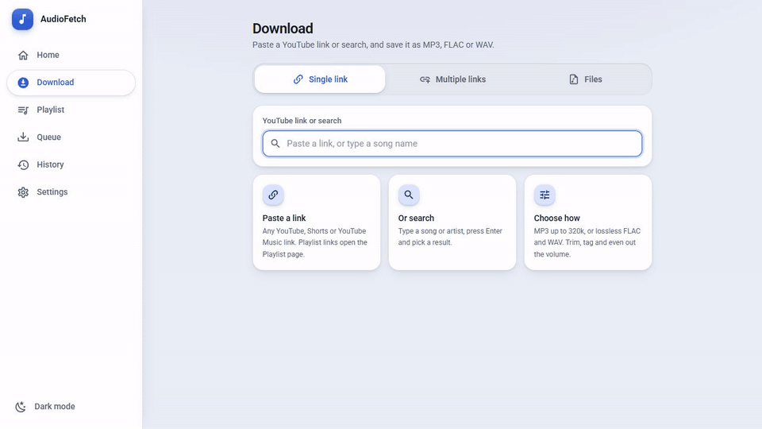
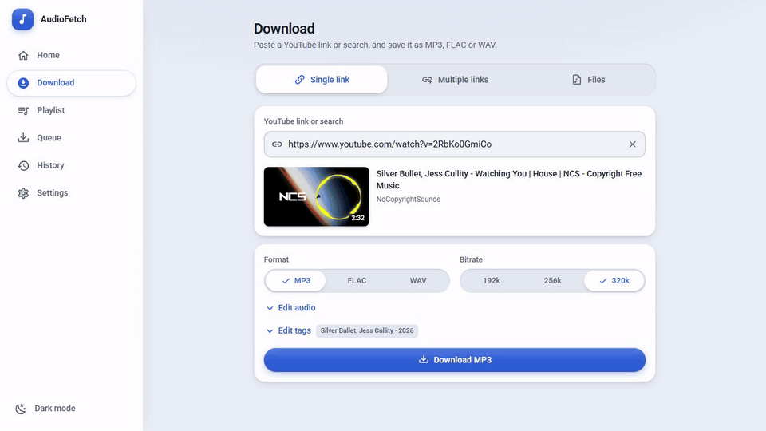
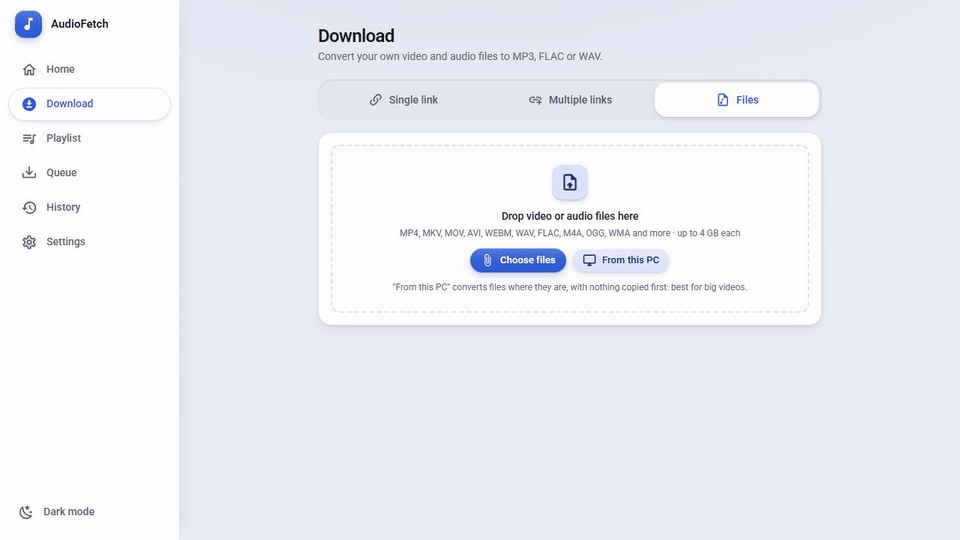
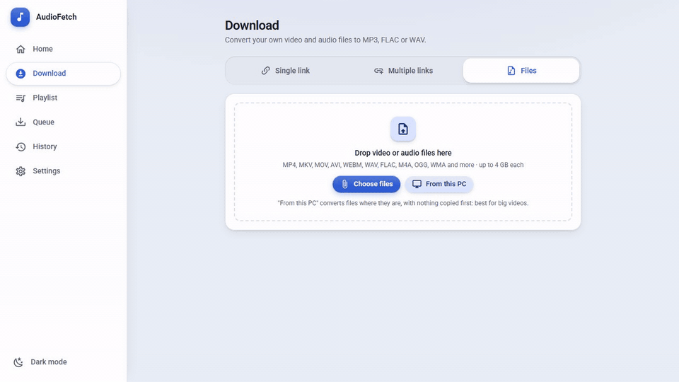
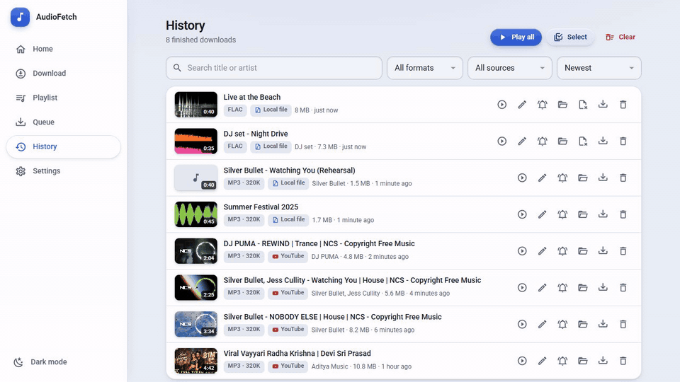
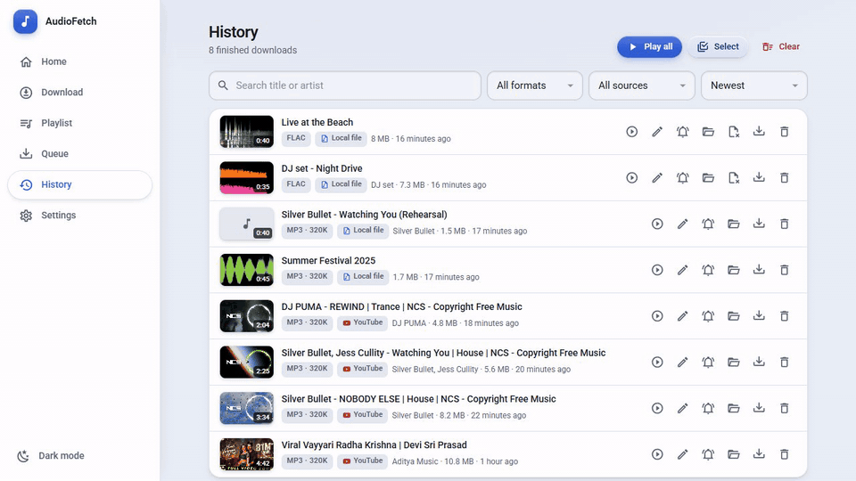
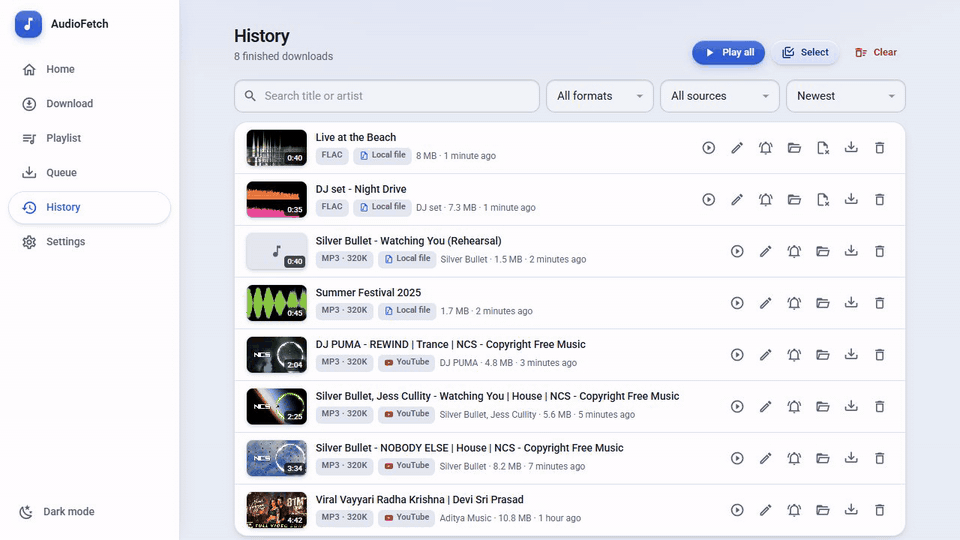
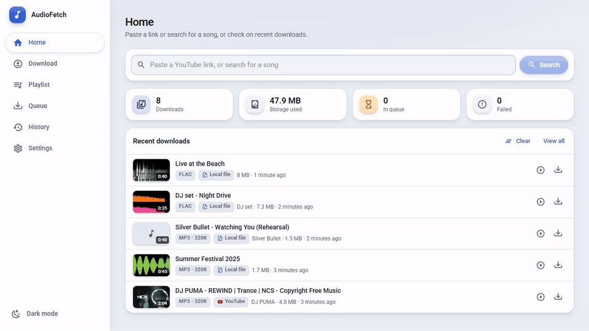
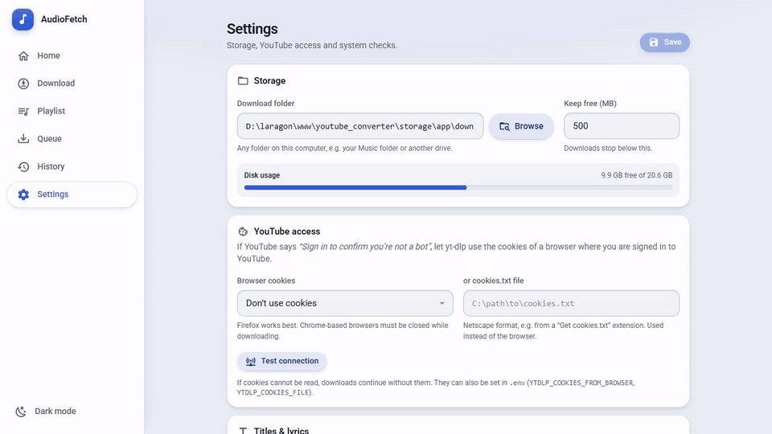
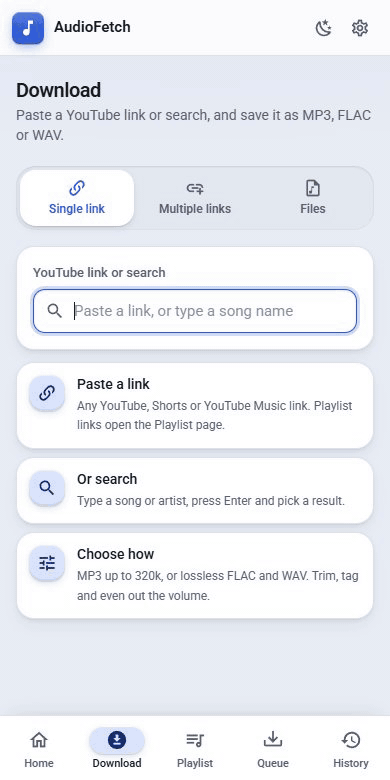

# 🎵 AudioFetch (Self-Hosted)
A self-hosted application to download and convert YouTube videos, and your own video and audio files, to high-quality MP3, FLAC or WAV. Built with **Laravel 13**, **Vue.js 3**, and **Tailwind CSS**.

<a id="walkthrough"></a>
## 🎬 Walkthrough
A short clip for each feature: click one to open it. The full 9-minute video tour (recorded before the Files tab) and more screenshots are in [docs/walkthrough](docs/walkthrough/README.md).

<details>
<summary><b>Search and download</b>: Search YouTube by name, pick a result, watch live progress, play it.</summary>


</details>

<details>
<summary><b>Trim, even volume and tags</b>: Keep part of a song, cut silence, level the volume, set the tags.</summary>


</details>

<details>
<summary><b>Multiple links and the queue</b>: Paste a list of links; songs you already have are skipped.</summary>


</details>

<details>
<summary><b>Convert your own files</b>: Upload videos or audio and convert them to MP3, FLAC or WAV.</summary>


</details>

<details>
<summary><b>Convert files on this PC</b>: Convert files where they are; originals are only deleted if you say so.</summary>


</details>

<details>
<summary><b>History</b>: Search, filter by format or source, edit tags, select songs for a ZIP.</summary>


</details>

<details>
<summary><b>Player</b>: Waveform seek bar, next, shuffle and repeat while you browse.</summary>


</details>

<details>
<summary><b>Ringtone maker</b>: Pick a part of a song, preview it and save it as an MP3.</summary>


</details>

<details>
<summary><b>Home</b>: Totals and recent downloads; Clear only hides them.</summary>


</details>

<details>
<summary><b>Settings and themes</b>: Download folder, accent colours, light and dark.</summary>


</details>

<details>
<summary><b>On your phone</b>: The same app on a phone, with the bottom menu and mini player.</summary>


</details>


## 📚 Table of Contents
- [Walkthrough](#walkthrough)
- [About](#about)
- [Important Disclaimer & Terms of Use](#disclaimer)
- [Run with Docker](#docker)
- [Run on a Server](#server)
- [Full Setup](#full-setup)
- [Run the App](#run-the-app)
- [Converting your own files](#convert-files)
- [Scheduler Setup](#scheduler-setup)
- [Running Tests](#testing)
- [Health Checks & Troubleshooting](#health-checks)

<a id="about"></a>
## ℹ️ About
This project is a self-hosted YouTube audio converter built as a learning-driven passion project. It focuses on practical Laravel queue processing, media conversion workflows (`yt-dlp` + `ffmpeg`), and a modern Vue-based UI for personal experimentation.
<a id="disclaimer"></a>

## ⚠️ Important Disclaimer & Terms of Use
This project is a hobbyist experiment and is provided strictly for educational and demonstration purposes. Before exploring or implementing this codebase, please note the following:


- **Use at Your Own Risk:** This software is free to use, but it is provided "as-is" without any warranties of any kind. By using this code, you acknowledge that you do so at your own discretion.
- **Compliance Warning:** Use of this codebase may not align with Google’s (or other third-party) Service Policies. It is your responsibility to ensure that your specific implementation complies with the Terms of Service of any platforms or APIs you integrate with.
- **No Developer Liability:** The creator of this project shall not be held responsible or liable for any damages, data loss, account suspensions, or financial losses incurred by individuals or businesses who choose to adapt this code into a live product.
- **Not a Commercial Product:** This is a passion project, not a commercial offering. If you decide to transform this hobbyist codebase into a commercial product, you assume 100% of the legal and technical responsibility.

In short: Use it, learn from it, and break it—but do so with caution!

## ✨ Features
- **Search or paste**: Search YouTube by song name right in the app, or paste a video/YouTube Music link.
- **Several links at once**: Paste a list of links and queue them all.
- **Playlist Support**: Bulk import entire playlists with smart selection.
- **Convert your own files**: Turn videos and audio files (MP4, MKV, MOV, AVI, WEBM, WAV, FLAC, M4A, OGG, WMA and more) into MP3, FLAC or WAV. Upload them from any browser, phone included, or pick them from a folder on the computer running the app. See [Converting your own files](#convert-files).
- **High Quality**: MP3 (up to 320 kbps), FLAC (lossless) and WAV (24-bit / 48 kHz).
- **Trim, silence removal & even volume**: Keep only part of a song, cut silent intros/outros, and bring every song to the same loudness.
- **Split by chapters**: Videos with chapters (DJ sets, albums) can be saved as one file per track.
- **Clean titles & tags**: Removes "(Official Music Video)", "[HD]" and similar; tags title, artist, album, year, genre and cover art. Files are named after the title. Edit tags later from History.
- **Lyrics**: Timed lyrics from LRCLIB, shown in the player and saved in the file.
- **Built-in player**: Play, seek on the song's waveform, play all, shuffle, repeat, next/previous, media keys.
- **Ringtone maker**: Pick the part of a song and save it as a short MP3 ringtone.
- **History**: Search, filter by format or by source (YouTube or your own files), show a file in its folder, and delete it.
- **Download as ZIP**: Select several songs in History and save them as one ZIP file.
- **Notifications**: A system notification when downloads finish or fail.
- **Colour themes**: Light or dark, with any accent colour.
- **Any download folder**: Browse and pick a folder (or create one) in Settings.
- **Optional password**: Lock the app with `APP_PASSWORD` when it runs on a server.
- **Queue System**: Background processing with retries and rate limiting.
- **Setup checklist**: First-run check of yt-dlp, FFmpeg, Deno, the queue worker and storage, with fix commands.
- **One-click yt-dlp update** from the Settings page.
- **Installable app (PWA)**: Install it on desktop or phone like a native app.
- **Docker**: One command to run everything, tools included.
- **Responsive Design**: Material-style light and dark themes for phone, tablet and desktop.

## 🛠️ Requirements
- **OS**: Windows, Linux, or macOS
- **PHP**: `>= 8.2`
- **Composer**: `>= 2.x`
- **Node.js**: `>= 18` and npm
- **Database**: MySQL or MariaDB
- **System tools**:
  - `yt-dlp` (downloader)
  - `ffmpeg` (audio conversion)

<a id="docker"></a>
## 🐳 Run with Docker
The easiest way: no PHP, Node, yt-dlp or FFmpeg to install. Requires [Docker](https://docs.docker.com/get-docker/).

```bash
git clone https://github.com/Abhijithsp/youtube_to_mp3_converter.git
cd youtube_to_mp3_converter
docker compose up -d
```

Open **http://localhost:8000**. Converted files appear in the `downloads/` folder next to `docker-compose.yml`; the database and settings live in `docker-data/`.

- Use another port: `APP_PORT=9000 docker compose up -d`
- Update to a newer version of the app: `git pull && docker compose up -d --build`
- If YouTube asks to *confirm you're not a bot*: export a `cookies.txt` from your browser (e.g. with a "Get cookies.txt" extension), put it in `docker-data/`, and uncomment `YTDLP_COOKIES_FILE` in `docker-compose.yml`. Reading browser cookies directly does not work inside Docker.

<a id="server"></a>
## 🌐 Run on a Server
The app is made for your own use. On your computer it needs no login. To run it on a server (a VPS, a home server, a NAS) for yourself:

1. **Set a password** in `.env` (or `docker-compose.yml`):
   ```env
   APP_PASSWORD=choose-a-long-password
   ```
   Every browser then asks for it once and remembers it for 30 days. Without it, anyone who finds the address can use your server to download and can browse its folders. To keep the password out of `.env` in plain text, run `php artisan app:hash-password` and paste the line it prints. In `docker-compose.yml`, write each `$` of a hash as `$$`.
2. **Choose where files go**: *Settings → Storage → Browse* lists the folders on the server (drives, home, Music, the Docker `/downloads` volume) and can create a new one. Get files onto your phone or PC with the download button in History.
   Converting files that are already on the server (*Download → Files → From this PC*) is only offered when a password is set, or from a browser on the server itself. Uploading files to convert works from every device.
3. **Use HTTPS** (e.g. Caddy, nginx + Let's Encrypt, or a Cloudflare/Tailscale tunnel) so the password is not sent in plain text. The app also works as an installable app (PWA) only over HTTPS.
4. Run the queue worker and scheduler as services (see [Scheduler Setup](#scheduler-setup)); `php artisan dev` is meant for your own computer.

To lock a device again, use *Settings → Access → Lock this device*. Changing `APP_PASSWORD` locks every device.

<a id="full-setup"></a>
## 🚀 Full Setup
### 1) Clone and install dependencies
```bash
git clone <your-repo-url>
cd youtube_converter
composer install
npm install
```

### 2) Environment setup
```bash
cp .env.example .env
php artisan key:generate
```

PowerShell equivalent:
```powershell
Copy-Item .env.example .env
php artisan key:generate
```

### 3) Database setup (MySQL/MariaDB)
Create an empty database (for example `audiofetch`) in MySQL or MariaDB, then set it in `.env`:
```env
DB_CONNECTION=mysql
DB_HOST=127.0.0.1
DB_PORT=3306
DB_DATABASE=your_db_name
DB_USERNAME=your_db_user
DB_PASSWORD=your_db_password
```

Then run:
```bash
php artisan migrate
php artisan db:seed --class=SettingsSeeder
```

### 4) Install and verify system dependencies
```bash
yt-dlp --version
ffmpeg -version
```

If not recognized, add both binaries to your system `PATH` and restart your terminal.

### 5) Optional app env overrides
```env
APP_PASSWORD=                                 # set one when running on a server (see Run on a Server)
YOUTUBE_DOWNLOAD_PATH=storage/app/downloads   # absolute, or relative to the project folder
MAX_PLAYLIST_SIZE=50
RATE_LIMIT_SECONDS=2
MIN_DISK_SPACE_MB=500
YOUTUBE_JOB_TIMEOUT=600
YOUTUBE_JOB_TRIES=3
MAX_UPLOAD_MB=4096                            # largest file that can be uploaded for conversion

# If YouTube asks you to "Sign in to confirm you're not a bot" (also on the Settings page)
YTDLP_COOKIES_FROM_BROWSER=firefox   # firefox, chrome, edge, brave, ... (Chromium browsers must be closed)
YTDLP_COOKIES_FILE=                  # or an exported Netscape cookies.txt file
```

<a id="run-the-app"></a>
## ▶️ Run the App
### Recommended (single command)
```bash
composer run dev
```

This starts:
- Laravel dev server
- Queue listener
- Log stream (`php artisan pail`)
- Vite dev server

App URL:
- `http://127.0.0.1:8000`

### Alternative (separate terminals)
Terminal 1:
```bash
php artisan serve
```

Terminal 2:
```bash
php artisan queue:work
```

Terminal 3:
```bash
npm run dev
```

Optional Terminal 4:
```bash
php artisan pail --timeout=0
```

<a id="scheduler-setup"></a>
## ⏱️ Scheduler Setup (Required for automated cleanup)
This app schedules a daily cleanup job (`CleanupOldDownloadsJob`) in `routes/console.php`. It removes old temporary files, and uploads for conversion that were never converted after a day.

### Local development
Run the scheduler worker in a separate terminal:
```bash
php artisan schedule:work
```

### Production (Linux cron)
Add this cron entry so Laravel checks scheduled tasks every minute:
```cron
* * * * * cd /path/to/youtube_converter && php artisan schedule:run >> /dev/null 2>&1
```

### Production (Windows Task Scheduler)
Create a task that runs every 1 minute with:
```powershell
php artisan schedule:run
```

### Verify scheduler is working
```bash
php artisan schedule:list
php artisan schedule:run
```

You should see the scheduled cleanup task in the list, and `schedule:run` should execute due tasks.

## 🏗️ Build for Production
```bash
npm run build
```

## 📖 Usage Guide
The **Download** page has three tabs:

- **Single link**: paste a YouTube link, or type a song name and press Enter to search. Pick the format (MP3, FLAC or WAV) and bitrate, optionally trim, tag or even out the volume, and press *Download*.
- **Multiple links**: paste several links (one per line) and queue them all at once.
- **Files**: convert your own video and audio files (see below).

Progress shows live, and the **Queue** page lists everything that is waiting or running. Finished songs are in **History**, where you can play them, edit tags, make a ringtone, show them in their folder, save them, or download several as a ZIP. Each song has a small label saying where it came from: **YouTube** or **Local file**.

**Home** shows your latest downloads. Its **Clear** button only hides them from Home (in this browser); nothing is deleted, and the songs stay in History. *Show recent again* brings them back.

<a id="convert-files"></a>
### 🎞️ Converting your own files
Open **Download → Files**, then:

1. **Add files**
   - **Choose files**, or drag files onto the page, uploads them from your browser. On a phone this opens the gallery, so you can convert a video you recorded. Files up to 4 GB are uploaded in small pieces (change the limit with `MAX_UPLOAD_MB`).
   - **From this PC** browses the folders of the computer running the app and converts files where they are, with nothing copied first. This is best for big videos. It only appears in a browser on that computer, or when the app has a password.
2. **Check the list.** Each file shows its length and audio quality. Title and artist come from the file's own tags, or else from its file name (with "(Official Video)" and similar removed). Use the pencil button to change the tags or trim a file. Files without sound are refused with a clear message.
3. **Choose the format, bitrate, *Remove silence* and *Even out volume*** (they apply to all files), and press **Convert**.

The converted songs are saved in your download folder and appear in History next to your YouTube downloads, with cover art taken from the file or from a frame of the video. Lyrics, the player and the ringtone maker work the same way.

**Your originals are never changed or deleted automatically.** When files from this PC finish converting, the app asks whether to delete the originals: *Keep them* or *Delete originals*. You can also do this later with the *Delete original file* button in History. Deleting a converted song from History never touches its original. Uploaded files are temporary copies: they are removed from the server after conversion (unused uploads after a day), and the original stays on your device.

With Docker, *From this PC* sees the container's folders, such as the `/downloads` volume.

### 📲 Install as an app
Open the app in Chrome, Edge or Brave and use the **Install app** button in the menu (or the install icon in the address bar). On Android use *Add to Home screen*, on iPhone *Share → Add to Home Screen*. Browsers only offer installing on `localhost` or HTTPS.

<a id="testing"></a>
## 🧪 Running Tests
The test suite fakes `yt-dlp` and `ffmpeg`, so it runs offline in a few seconds (requires the `pdo_sqlite` PHP extension):
```bash
php artisan test
```

Real end-to-end downloads (needs network, `yt-dlp` and `ffmpeg`; YouTube may rate-limit repeated runs):
```bash
php artisan test --group=integration
```

<a id="health-checks"></a>
## 🩺 Health Checks & Troubleshooting
### Useful checks
```bash
php artisan about
php artisan route:list
php artisan queue:failed
php artisan optimize:clear
```

### Jobs stuck / no progress
- Ensure worker is running: `php artisan queue:work`
- Retry failed jobs:
  ```bash
  php artisan queue:failed
  php artisan queue:retry all
  ```

### "Sign in to confirm you're not a bot" / HTTP Error 429
YouTube rate-limits computers that make many requests. Wait a few minutes, or let yt-dlp use your YouTube login:
- **Settings → YouTube access**: pick the browser you are signed in with (Firefox works best; Chrome/Edge/Brave must be closed while downloading), or point to a `cookies.txt` file exported with a "Get cookies.txt" browser extension.
- Use **Test connection** to check it. If cookies can't be read, downloads continue without them.

### Downloads fail with "HTTP Error 403"
YouTube changes often; update yt-dlp: `yt-dlp -U` (or `winget upgrade yt-dlp` / `pip install -U yt-dlp`, depending on how you installed it).

### Songs won't play, or the app is slow while a song plays
`php artisan serve` (and `composer run dev`) runs PHP's built-in server, which handles one request at a time on Windows. A playing song can then hold up other requests: pages load slowly, or replaying a song briefly fails (the player retries once by itself). For everyday use, serve the app with a real web server, such as Laragon's Apache (`http://youtube_converter.test`), nginx, or Docker.

### `yt-dlp` / `ffmpeg` not found
- Verify commands:
  ```bash
  yt-dlp --version
  ffmpeg -version
  ```
- Ensure both are available in the same terminal environment as Laravel/queue.

### Frontend not updating
- Run `npm run dev` in development.
- Rebuild assets with `npm run build` if needed.

### Database issues
- Confirm DB values in `.env`.
- Reset and reseed:
  ```bash
  php artisan migrate:fresh --seed
  ```

## ⚡ One-Time Setup Shortcut
```bash
composer run setup
```

This runs:
- `composer install`
- creates `.env` if missing
- `php artisan key:generate`
- `php artisan migrate --force`
- `npm install`
- `npm run build`

Then start:
```bash
composer run dev
```

## 🤝 Contributing
Pull requests are welcome. For major changes, please open an issue first to discuss what you would like to change.

## 📝 License
[MIT](https://choosealicense.com/licenses/mit/)
