# AudioFetch walkthrough

https://github.com/user-attachments/assets/aa54e726-fb73-45d0-b07e-8d7a2a0d8af3

**Video:** [AudioFetch-walkthrough.mp4](AudioFetch-walkthrough.mp4) (1:53, 1366×768). A guided tour with captions: download preview, History and the player, selecting songs for a ZIP, the folder picker, accent colours and dark mode, notifications, and the password lock.

## Desktop

| Screenshot | What it shows |
| --- | --- |
| 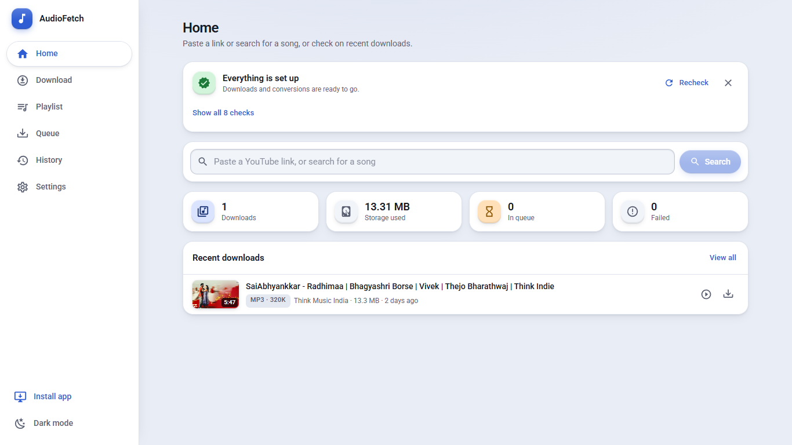 | Home |
| 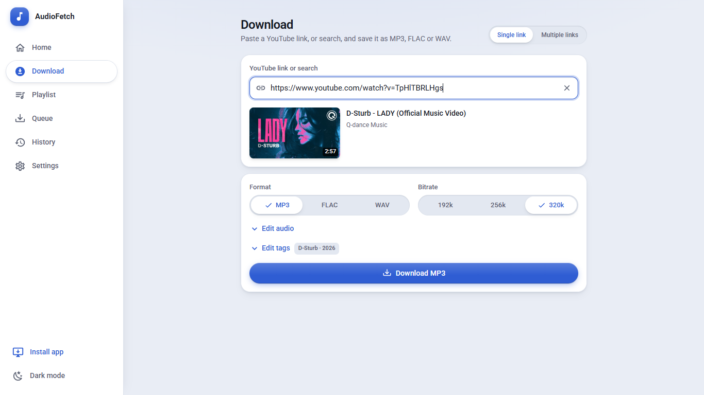 | Paste a link: title, cover and tags are filled in; choose format, bitrate and trim |
| 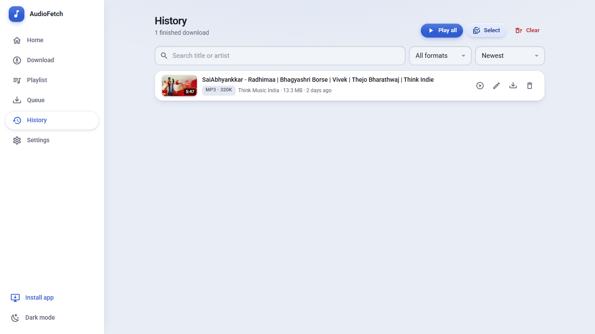 | History with play, edit tags, save and delete per song |
| 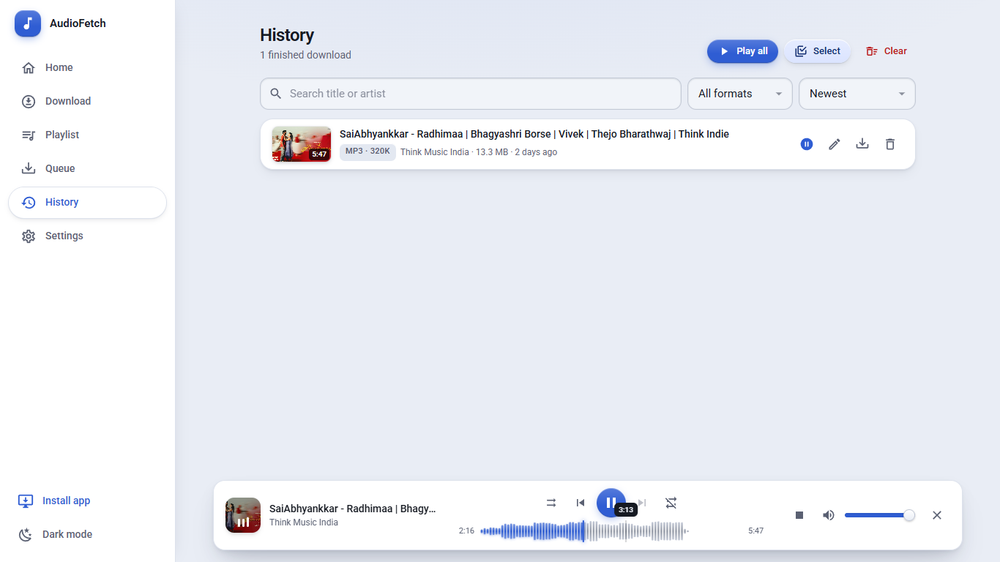 | Player with the waveform seek bar |
| 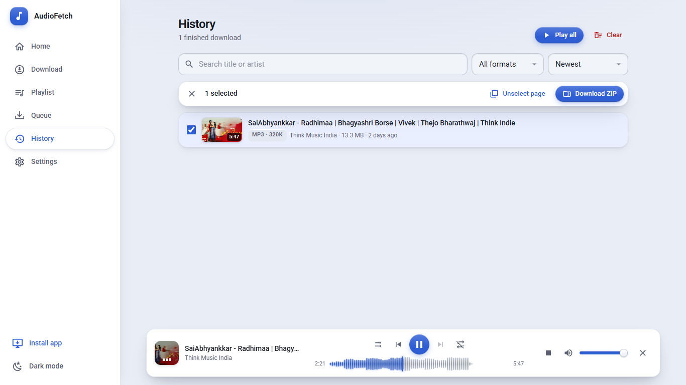 | **New:** Select songs, then **Download ZIP** |
| 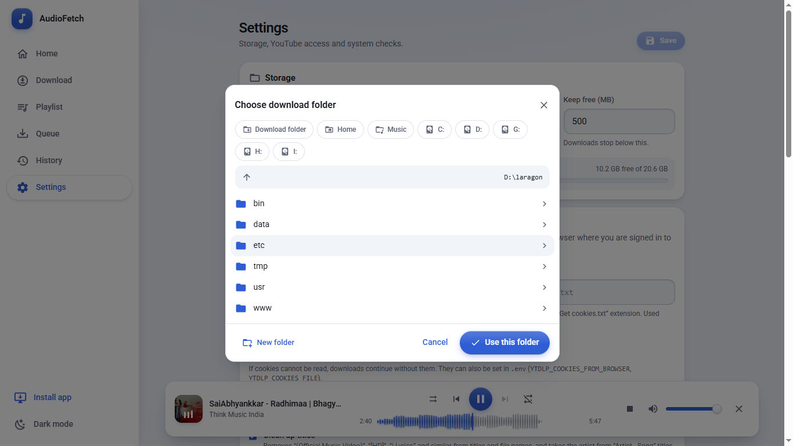 | **New:** Browse for any download folder (drives, Home, Music, new folder) |
| 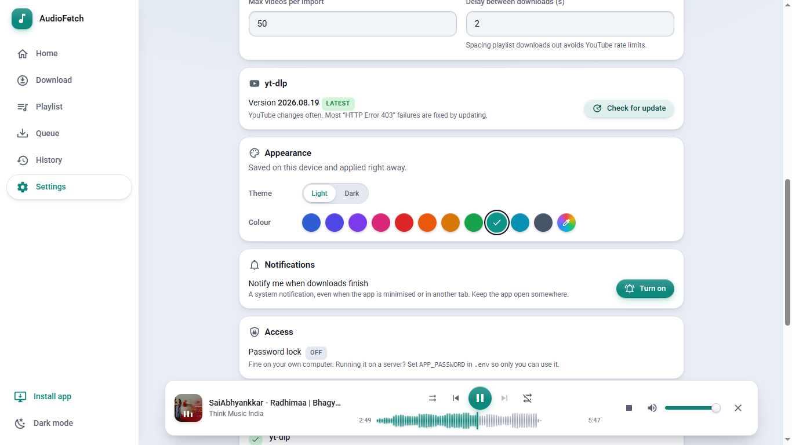 | **New:** Accent colour, the whole app follows |
| 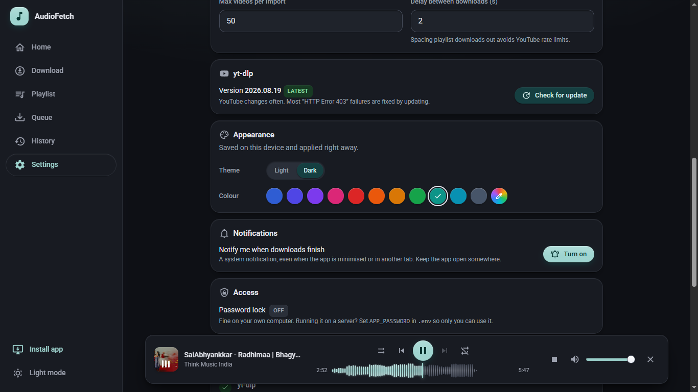 | Accent colour in dark mode |
| 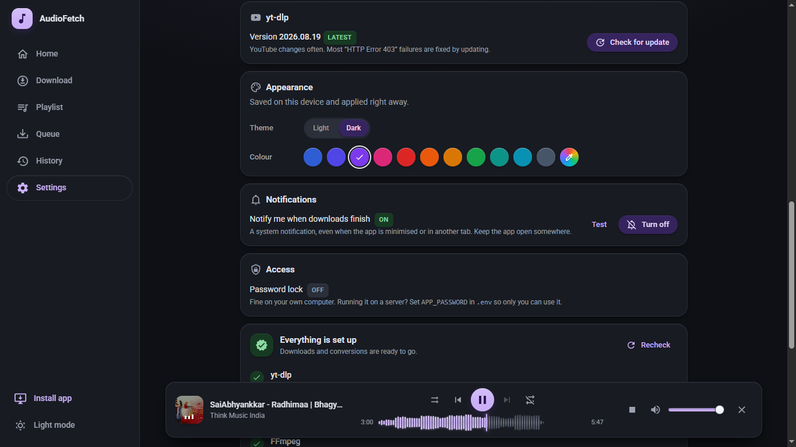 | **New:** System notifications when downloads finish |
| 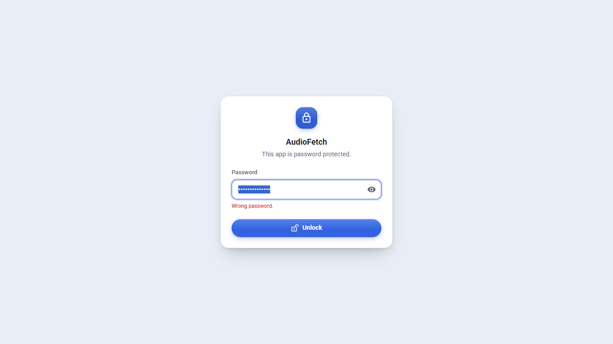 | **New:** Optional password lock (`APP_PASSWORD`) for servers |

## Phone

| Screenshot | What it shows |
| --- | --- |
| 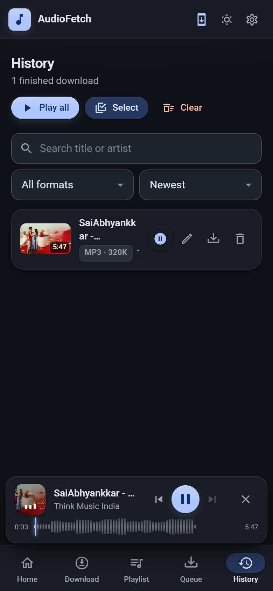 | History and the player |
| 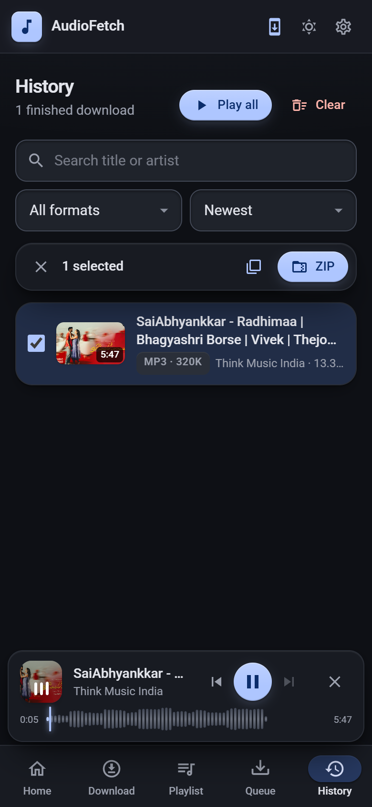 | Selecting songs for a ZIP |
| 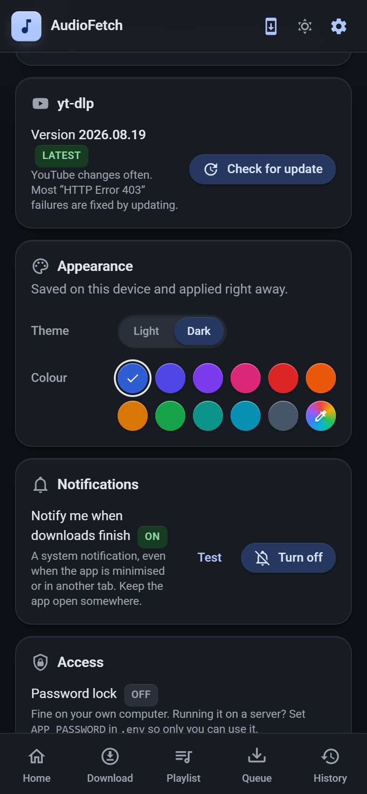 | Appearance and notification settings |
| 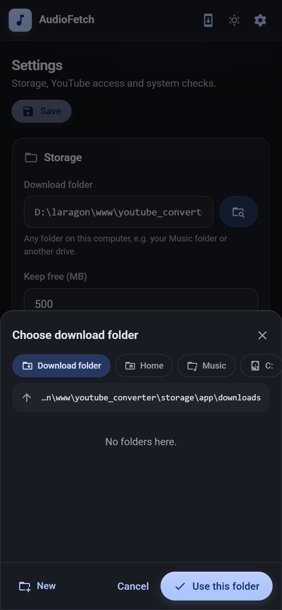 | Folder picker as a bottom sheet |
